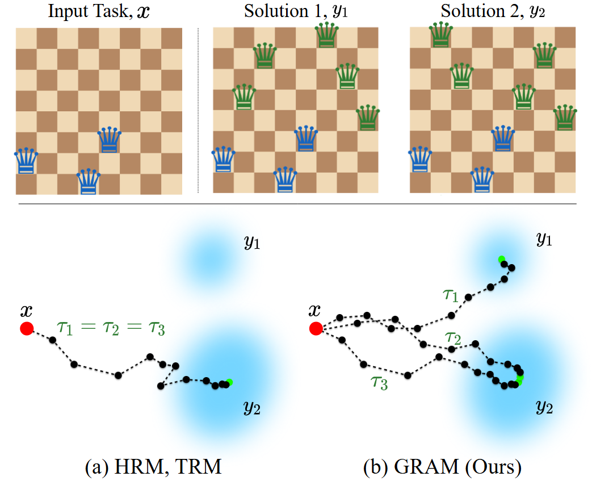

# Generative Recursive reAsoning Models (GRAM)
Author: Junyeob Baek*, Mingyu Jo*, Minsu Kim, Yoshua Bengio, Sungjin Ahn

This is official codebase for the paper: "Generative Recursive reAsoning Models". 
### Abstract
We introduce Generative Recursive reAsoning Models (GRAM), a recursion-based generative model that is effective for complex planning and reasoning problems. GRAM reformulates recent latent recursive architectures as a stochastic generative process with probabilistic latent transitions, enabling efficient and stable computation entirely in latent space without relying on token-level sequences as in chain-of-thought (CoT) prompting. We optimize this generative recursion via amortized variational inference, allowing the model to represent and explore multiple plausible latent trajectories conditioned on the input. This formulation supports both conditional reasoning through p(y|x) and unconditional generative modeling through p(x). Empirically, GRAM achieves strong performance on challenging reasoning benchmarks, competitive with much larger language models on ARC-1 and ARC-2, demonstrating the effectiveness of recursion-based generative modeling for System 2 tasks.

## Overview
<div align="center">

</div>


### Requirements

- Python 3.10 (or similar)
- Cuda 12.6.0 (or similar)

```bash
pip install --upgrade pip wheel setuptools
pip install --pre --upgrade torch torchvision torchaudio --index-url https://download.pytorch.org/whl/nightly/cu126 # install torch based on your cuda version
pip install -r requirements.txt # install requirements
pip install --no-cache-dir --no-build-isolation adam-atan2 
wandb login YOUR-LOGIN # login if you want the logger to sync results to your Weights & Biases (https://wandb.ai/)
```

### Dataset Preparation

```bash
# ARC-AGI-1
python -m dataset.build_arc_dataset \
  --input-file-prefix kaggle/combined/arc-agi \
  --output-dir data/arc1concept-aug-1000 \
  --subsets training evaluation concept \
  --test-set-name evaluation

# ARC-AGI-2
python -m dataset.build_arc_dataset \
  --input-file-prefix kaggle/combined/arc-agi \
  --output-dir data/arc2concept-aug-1000 \
  --subsets training2 evaluation2 concept \
  --test-set-name evaluation2

## Note: You cannot train on both ARC-AGI-1 and ARC-AGI-2 and evaluate them both because ARC-AGI-2 training data contains some ARC-AGI-1 eval data

# Sudoku-Extreme
python dataset/build_sudoku_dataset.py --output-dir data/sudoku-extreme-1k-aug-1000  --subsample-size 1000 --num-aug 1000  # 1000 examples, 1000 augments

# Sudoku Generation (blank board -> valid solution)
python dataset/build_sudoku_generation_dataset.py --output-dir data/sudoku-generation-50k --train-size 50000 --test-size 10000

# N-Queens
python dataset/build_nqueens_dataset.py --n 8 --remove-counts 5 6 7 --output-dir data/nqueens-8
python dataset/build_nqueens_dataset.py --n 10 --remove-counts 7 8 9 --output-dir data/nqueens-10

# Graph Coloring
python dataset/build_graph_coloring_dataset.py --config-name graph-coloring-8 --output-dir data/graph-coloring-8
python dataset/build_graph_coloring_dataset.py --config-name graph-coloring-10 --output-dir data/graph-coloring-10

# MNIST
python dataset/build_mnist_dataset.py --output-dir data/mnist_2 --vocab-levels 2 --test-vocab-levels 256 --threshold 0.5
```

## Experiments

```bash
# ARC-AGI-1 (4 H-100 GPUs, ~3 days)
bash scripts/arc1.sh

# ARC-AGI-2 (4 H-100 GPUs, ~3 days)
bash scripts/arc2.sh

# Sudoku-Extreme (8 RTX 4090 GPUs, < 2 hours)
bash scripts/sudoku.sh

# Sudoku Generation (8 RTX 4090 GPUs)
bash scripts/sudoku_generation.sh

# N-Queens (8 RTX 4090 GPUs, ~1 hour, ~3 hours)
bash scripts/nqueens_8.sh
bash scripts/nqueens_10.sh

# Graph Coloring (8 RTX 4090 GPUs, ~2 hours, ~6 hours)
bash scripts/graph_coloring_8.sh
bash scripts/graph_coloring_10.sh

# MNIST (8 RTX 4090 GPUs, ~16 hours)
bash scripts/mnist.sh
```

## Reference
TBD

This code is based on the Hierarchical Reasoning Model [code](https://github.com/sapientinc/HRM) and the Tiny Reasoning Model [code](https://github.com/SamsungSAILMontreal/TinyRecursiveModels).
